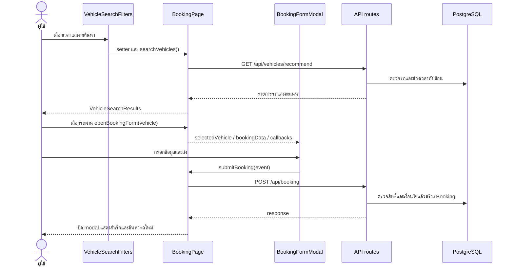

# บทที่ 2 — อ่าน frontend ทีละหน้าและเข้าใจ React ที่ใช้

## 1. รูปแบบของไฟล์หน้าเว็บ

หน้าใช้งานส่วนใหญ่ประกาศ `"use client"` เพราะต้องรับ event ใช้ state เปิด modal และเรียก API หลังแสดงหน้า ส่วน layout ที่ตรวจสิทธิ์เป็น Server Component ไม่มี directive นี้

หลัง refactor วันที่ 15 ตุลาคม 2026 โครงสร้างหน้าที่ปรับใหม่คือ imports จากไฟล์ข้างเคียง → page component → state → ฟังก์ชันเรียก API/handler → effects → JSX ที่ประกอบ component ลูก ส่วน type/interface, ค่าเริ่มต้น และ helper หลายตัวถูกย้ายไป types.ts/constants.ts/utils.ts ตารางฟังก์ชันในบทนี้อธิบายงานของ feature โดยตำแหน่งหลังย้ายดูส่วน 9 และดัชนีบท 6

```tsx
const [bookings, setBookings] = useState<Booking[]>([])

const fetchBookings = useCallback(async () => {
  const response = await api.get<Booking[]>("/api/booking?action=my-bookings")
  setBookings(response.data)
}, [])

useEffect(() => {
  fetchBookings()
}, [fetchBookings])
```

อ่านว่า: เริ่มจากรายการว่าง → หลัง component mount เรียก API → รอ response → เก็บข้อมูลใน state → React render รายการใหม่ `setBookings()` ไม่ได้เขียนฐานข้อมูล ส่วนการเขียนฐานข้อมูลเกิดจาก route ฝั่ง server

| แนวคิด | หน้าที่ | ตัวอย่างในโปรเจกต์ |
|---|---|---|
| `useState` | เก็บค่าที่มีผลต่อหน้าจอ | รายการรถ ค่า input สถานะ loading และ modal |
| `useEffect` | ประสานกับระบบภายนอกหลัง render พร้อม cleanup | โหลดข้อมูล ตั้ง polling ฟัง Escape |
| dependency array | กำหนดว่า effect/callback สัมพันธ์กับค่าใด | เปลี่ยน filters แล้วโหลดข้อมูลใหม่ |
| `useCallback` | รักษา reference ของฟังก์ชันจน dependency เปลี่ยน | fetchBookings, searchVehicles |
| `useMemo` | เก็บผลคำนวณไว้จน dependency เปลี่ยน | กรองรายการและรวมสถิติ |
| `useRef` | เก็บค่าข้าม render โดยแก้แล้วไม่ทำให้ render | กัน submit ซ้ำ, อ้าง DOM, จำตัวกรองก่อนหน้า |
| props | ค่าที่ parent ส่งให้ child | filters ของ VehicleHistoryDetails |
| `children` | เนื้อหาภายใน component/layout | layout ห่อ page |
| controlled input | input อ่านค่าจาก state และอัปเดตผ่าน onChange | email, purpose, mileageInput |
| conditional rendering | เลือกส่วนแสดงตามเงื่อนไข | loading / error / empty / list |
| `.map()` | แปลงรายการเป็น JSX หรือข้อมูลใหม่ | รถหนึ่งคันเป็นหนึ่งแถว |
| `.filter()` | เลือกเฉพาะรายการที่ตรงเงื่อนไข | เฉพาะ PENDING |
| `.reduce()` | ยุบหลายรายการเป็นผลรวม | สถิติจำนวนการจอง |

`useCallback` และ `useMemo` ไม่ได้ทำให้ข้อมูลอัปเดตจาก server เอง และไม่ใช่ cache ฐานข้อมูล

`e.preventDefault()` กัน form submit แบบ browser ที่เปลี่ยนหน้า แล้วให้โค้ดส่ง request เอง `try/catch/finally` แยกเส้นทางสำเร็จ ผิดพลาด และงานที่ต้องทำเสมอ เช่นปิด loading

## 2. กรอบเว็บและเมนูร่วม

### app/layout.tsx

[RootLayout](/Users/chatchaponchuwongwut/Desktop/mut/project_1/vehicle-management/app/layout.tsx) ใส่ `<html lang="th">`, `<body>`, Navbar และ children พร้อม metadata ชื่อเว็บ การ import `globals.css` ที่นี่ทำให้ CSS ใช้ทั้งเว็บ

### app/globals.css และ class ใน JSX

[globals.css](/Users/chatchaponchuwongwut/Desktop/mut/project_1/vehicle-management/app/globals.css) import Tailwind, ประกาศสี background/foreground, ฟอนต์ และค่าตาม dark preference งานตกแต่งส่วนใหญ่เกิดใน JSX ผ่าน class เช่น:

```tsx
className="grid grid-cols-1 gap-4 md:grid-cols-2 xl:grid-cols-3"
```

หมายถึงใช้ grid ช่องเดียวบนจอเล็ก แล้วเพิ่มคอลัมน์ตาม breakpoint `bg-*` คือพื้นหลัง, `text-*` คือสี/ขนาดตัวอักษร, `px/py` คือ padding, `rounded-*` คือมุมโค้ง, `hover:*` คือเมื่อชี้, `disabled:*` คือปุ่มที่ใช้ไม่ได้ และ `focus:*` ช่วยบอกตำแหน่ง keyboard focus

ตารางมักอยู่ใน `overflow-x-auto` เพื่อเลื่อนแนวนอนบนจอเล็ก ส่วน modal ใช้ `fixed inset-0` คลุมหน้าจอและ `z-50` อยู่เหนือเนื้อหา

### app/component/navbar.tsx

[Navbar](/Users/chatchaponchuwongwut/Desktop/mut/project_1/vehicle-management/app/component/navbar.tsx) ถูกเรียกจาก RootLayout จึงใช้ร่วมทุกหน้า แต่คืน `null` เมื่อ pathname เป็น `/`

| ส่วน | การทำงาน |
|---|---|
| effect ตาม `pathname` | เรียก `/api/auth/me` เมื่อเปลี่ยนหน้า เก็บ user |
| ตัวแปร `active` | กัน response ที่กลับมาหลัง cleanup ไปเปลี่ยน state ของ effect เก่า |
| `fetchNotifications()` | GET `/api/notifications?limit=10` และเก็บ unreadCount |
| interval | โหลด notification ทุก 30 วินาที; cleanup ล้าง interval |
| `notificationRef` | ตรวจว่าคลิกอยู่นอกกล่อง notification หรือไม่ |
| effect เมื่อเปิดกล่อง | ปิดเมื่อคลิกด้านนอกหรือกด Escape และถอด event listener ตอน cleanup |
| `openNotification()` | PATCH ให้รายการอ่านแล้ว ปรับ state แล้วนำไปหน้าจอง/ซ่อมตามประเภท |
| `markAllAsRead()` | PATCH `{markAll: true}` แล้วทำรายการใน state เป็นอ่านแล้ว |
| `handleLogout()` | POST `/api/auth/logout` แล้วกลับ `/` ใน finally |

นี่เป็น polling ไม่ใช่ WebSocket และการกด notification พาไปหน้ารวม ไม่ได้เปิดรายละเอียด bookingId โดยตรง

### app/component/role-dashboard.tsx

[RoleDashboard](/Users/chatchaponchuwongwut/Desktop/mut/project_1/vehicle-management/app/component/role-dashboard.tsx) รับ `title`, `description`, `items` แล้วแสดงการ์ดเมนู ใช้ `router.push(item.href)` เมื่อกด มี `toneClasses` จับคู่ชื่อโทนกับชุดสี และแสดง empty state หากไม่มีเมนู

`DashboardLoading()` เป็น skeleton ระหว่างโหลด หน้านี้ไม่ได้ตรวจสิทธิ์เอง ผู้เรียกกรอง `items` ก่อนส่งมา จึงต้องมีการป้องกันใน layout/API ด้วย

## 3. หน้า login และ dashboard

### app/page.tsx — /

[LoginPage](/Users/chatchaponchuwongwut/Desktop/mut/project_1/vehicle-management/app/page.tsx) เก็บ email, password, error, loading และ showPassword

`handleLogin()` รับ submit → ป้องกัน reload → POST `/api/auth/login` → อ่าน `response.data.user.role` → นำไป `/admin`, `/approver` หรือ `/user` ตาม role การเก็บ token ทำโดย browser จาก cookie ใน response ไม่ได้เก็บใน localStorage

`getLoginErrorMessage()` อ่าน message จาก Axios error, `fillAccount()` เติมข้อมูลบัญชีสาธิตลงฟอร์ม และปุ่ม Eye เปลี่ยนชนิด input ระหว่าง password/text

ภาพพื้นหลังใช้ `/wall4.avif` และโลโก้ `/pea_logo.png` ผ่าน `next/image` ภาพอื่นใน public ที่ไม่ได้อ้างใน JSX ไม่ได้ถูกแสดงทุกภาพโดยอัตโนมัติ

### app/user/page.tsx — /user

[UserPage](/Users/chatchaponchuwongwut/Desktop/mut/project_1/vehicle-management/app/user/page.tsx) GET `/api/auth/me`, กรอง allMenuItems ด้วย permissions แล้วส่งให้ RoleDashboard มีเมนูจองรถ การจองของฉัน และแจ้งซ่อม

### app/admin/page.tsx — /admin

[AdminPage](/Users/chatchaponchuwongwut/Desktop/mut/project_1/vehicle-management/app/admin/page.tsx) ใช้รูปแบบเดียวกัน มีผู้ใช้ รถ การจอง ซ่อม รายงาน และสิทธิ์ การเข้าหน้าอ่านข้อมูลอาจใช้ VIEW ขณะที่ปุ่มเปลี่ยนข้อมูลใช้ MANAGE

### app/approver/page.tsx — /approver

[ApproverPage](/Users/chatchaponchuwongwut/Desktop/mut/project_1/vehicle-management/app/approver/page.tsx) โหลด permissions ก่อน ถ้ามี BOOKING_APPROVE จึง GET `/api/approver?status=PENDING` เพื่อแสดงจำนวนงานค้าง มีเมนูอนุมัติและประวัติ

## 4. หน้าผู้ใช้

### app/user/booking/page.tsx — ค้นหาและจองรถ

[BookingPage](/Users/chatchaponchuwongwut/Desktop/mut/project_1/vehicle-management/app/user/booking/page.tsx) ใช้ API แนะนำรถเป็นเส้นทางค้นหาหลัก ไม่ได้ใช้ GET `/api/booking` เพื่อแสดงรถในหน้านี้

| ฟังก์ชัน/ค่า | ทำอะไร | ข้อมูล/API |
|---|---|---|
| `fetchVehicleTypes()` | โหลดประเภทลง select | GET `/api/verhicle-type` |
| `searchVehicles()` | สร้าง query จากวันเริ่ม–สิ้นสุดและประเภท เก็บรถที่จัดอันดับแล้ว | GET `/api/vehicles/recommend` |
| `openBookingForm(vehicle)` | จำรถที่เลือก นำช่วงค้นหามาใส่ฟอร์ม และเปิด modal | selectedVehicle, bookingData |
| `closeBookingForm()` | ปิดและล้างฟอร์ม | INITIAL_BOOKING_DATA |
| `submitBooking()` | ส่ง purpose/destination/ช่วงเวลา/รถ ปิด modal และโหลดรถใหม่ | POST `/api/booking` |
| `getLocalDateTimeInputValue()` | เตรียมรูปแบบ YYYY-MM-DDTHH:mm สำหรับ input ตาม local time | ชดเชย timezone offset ก่อน slice |
| `minEndDateTime` | ตั้ง min ของเวลาสิ้นสุดในช่องค้นหาเป็นเริ่ม + 1 ชั่วโมง | กฎระดับ UI |
| `canSearch` | เปิดปุ่มค้นหาเมื่อเลือกทั้งสองวัน | state ของช่วงเวลา |
| effect ของ modal | ปิดด้วย Escape | event listener |

ลำดับ state: เลือกเวลา → กดค้นหา → vehicles ถูกเติม → เลือกรถ → showBookingForm = true → กรอกวัตถุประสงค์/ปลายทาง → ส่งคำขอ → server สร้าง PENDING

ป้าย recommended มาจาก server ค่าคะแนนไม่ได้คำนวณใน component และกฎเริ่ม + 1 ชั่วโมงใน UI ไม่เท่ากับกฎของ POST ซึ่งตรวจเพียงว่า end ต้องหลัง start

### app/user/my-bookings/page.tsx — การจองของฉัน

[MyBookingsPage](/Users/chatchaponchuwongwut/Desktop/mut/project_1/vehicle-management/app/user/my-bookings/page.tsx) รวมการติดตามและดำเนินงานของเจ้าของการจอง มี modal 4 แบบ: detail, edit, pickup, return

| ฟังก์ชัน | การทำงาน |
|---|---|
| `fetchBookings()` | GET `/api/booking?action=my-bookings` เก็บรายการและสถิติ |
| `buildStats()` | reduce นับ status ที่มี key อยู่ใน INITIAL_STATS |
| `filteredBookings` | useMemo กรองตามสถานะที่เลือก |
| `openDetailModal()` | เลือกรายการเพื่อแสดงข้อมูล |
| `openEditModal()` | เติมวัน purpose และ destination ลง editForm |
| `handleEditSubmit()` | PATCH `/api/booking` แล้วโหลดรายการใหม่ |
| `cancelBooking()` | confirm แล้ว PUT `/api/booking` ด้วย CANCELLED |
| `openMileageModal()` | เลือก action รับหรือคืน และล้าง input |
| `handlePickup()` | แปลง mileageInput เป็น Number แล้ว PUT `/api/booking/pickup` |
| `handleReturn()` | PUT `/api/booking/return` ด้วย mileageEnd |
| `closeModal()` | ล้าง selectedBooking, mileageInput และ editForm |
| `getDistance()` | คืนผลต่างเลขไมล์ หรือ null เมื่อยังขาดค่า |

ปุ่มแก้ไข/ยกเลิกแสดงเฉพาะ PENDING ปุ่มรับรถแสดงสำหรับ APPROVED/CHANGED และปุ่มคืนสำหรับ IN_PROGRESS โดยต้องมี BOOKING_CREATE ด้วย การดูรายการใช้ BOOKING_VIEW จึงมีกรณีดูได้แต่กดเปลี่ยนไม่ได้

Component ย่อยที่ย้ายไปไฟล์ใน `app/user/my-bookings/_components/` แล้ว:

| Component | เหตุผลที่แยก |
|---|---|
| `ModalHeader` | ส่วนหัว คำอธิบาย และปุ่มปิดใช้ซ้ำ |
| `BookingDetailPanel` | ข้อมูลรถ เวลา purpose/destination ผู้อนุมัติและเลขไมล์ |
| `PrimaryButton` | ปุ่มหลักรูปแบบร่วม |
| `ModalActions` | ปุ่มยกเลิก/บันทึกและข้อความ loading |
| `MileageModal` | ใช้ฟอร์มเดียวกับรับและคืน โดยเปลี่ยน props เช่น label, min, tone, onSubmit |

มีข้อสังเกตของ UI ปัจจุบัน: INITIAL_STATS ไม่มี `changed` และ filter ไม่มี CHANGED แยก แม้รายการ CHANGED ยังแสดงใน “ทั้งหมด” และรับรถได้ อย่าใช้จำนวนในกล่อง “อนุมัติแล้ว” เป็นจำนวนรวม APPROVED + CHANGED โดยไม่ดู buildStats

### app/user/maintenance/page.tsx — แจ้งซ่อมและติดตาม

[UserMaintenancePage](/Users/chatchaponchuwongwut/Desktop/mut/project_1/vehicle-management/app/user/maintenance/page.tsx) ใช้ `fetchData()` โหลดงานซ่อมของตนและรายการรถด้วย Promise.all จาก `/api/user/maintenance` และ `/api/verhicle`

`getInitialFormData()` ตั้งเวลาเริ่มเป็นเวลาปัจจุบันใน local input, `openReportModal()` ล้างข้อมูลเดิม, `handleSubmit()` POST งานซ่อมแล้วโหลดข้อมูลใหม่, `buildStats()` นับความคืบหน้า และ `maintenanceTypeLabels` แปลประเภทเป็นภาษาไทย

สิทธิ์ MAINTENANCE_VIEW ใช้ดูหน้า ส่วน MAINTENANCE_REPORT ใช้แสดงปุ่มแจ้ง ประเภทที่สร้างใหม่เลือก BREAKDOWN/PREVENTIVE/OTHER; UNSPECIFIED มีไว้รองรับข้อมูลเดิม ไม่ใช่ตัวเลือกปกติของรายงานใหม่

## 5. หน้าผู้อนุมัติ

### app/approver/approve/page.tsx

[ApproverBookingsPage](/Users/chatchaponchuwongwut/Desktop/mut/project_1/vehicle-management/app/approver/approve/page.tsx) มีแท็บ PENDING, APPROVED และ REJECTED

`fetchBookings()` โหลดตาม selectedStatus → `openApprovalModal()` เก็บรายการและ action → `submitApproval()` PUT `/api/approver` ด้วย `{id, action, comment}` → ปิด modal และ refresh

`submittingRef.current` กันกด submit ซ้ำก่อน state loading render รอบใหม่ แต่ไม่ได้แทนการจัดการ concurrency ในฐานข้อมูล API ยังมีการตรวจสถานะอีกชั้น เมื่อปฏิเสธต้องมีเหตุผล

### app/approver/history/page.tsx

[ApprovalHistoryPage](/Users/chatchaponchuwongwut/Desktop/mut/project_1/vehicle-management/app/approver/history/page.tsx) GET `/api/approver?status=ALL` ซึ่ง server จำกัดประวัติ APPROVER ด้วย approverId แล้วหน้าเว็บคัดเฉพาะ APPROVED/CHANGED/REJECTED

`filterByDate()` และ `buildStats()` อยู่ใน utils.ts: ตัวแรกกรองด้วย `updatedAt` ตัวหลังนับ APPROVED และ CHANGED ในจำนวนอนุมัติ; `approvalRate` อยู่ใน _components/HistoryStats.tsx คำนวณ approved / total × 100 ปัดเป็นจำนวนเต็ม; `viewDetails()` ยังอยู่ใน page และเปิดรายละเอียด

ต้องอธิบายให้ตรง: นี่ไม่ใช่ประวัติการตัดสินทั้งหมดตลอดอายุรายการ เพราะหน้าเว็บตัด IN_PROGRESS และ COMPLETED ออก และ updatedAt เปลี่ยนได้จากการดำเนินงานอื่นด้วย ไม่มี approvedAt แยกใน schema

## 6. หน้าผู้ดูแล

### app/admin/users/page.tsx

[AdminUsersPage](/Users/chatchaponchuwongwut/Desktop/mut/project_1/vehicle-management/app/admin/users/page.tsx) โหลด `/api/user` คู่กับ `/api/auth/me` เพื่อรู้ทั้งรายการและบัญชีตนเอง

`createUser()` ส่งชื่อ/email/password/role ด้วย POST; `updateUser()` ส่งเฉพาะ id/name/role ด้วย PUT; `deleteUser()` ใช้ DELETE; `toggleUserStatus()` ใช้ PATCH เปลี่ยน isActive หลังแสดงจำนวนการจองที่ยังค้าง

UI แยก ALL/ACTIVE/INACTIVE ป้องกันกดปิดบัญชีตนและแสดงปุ่มลบเมื่อ `canDelete` จาก API อนุญาต มีการอัปเดต array ผ่าน map/filter หลัง response สำเร็จ ไม่จำเป็นต้องโหลดตารางใหม่ทุกครั้ง

`getInitials()` นำอักษรตัวแรกมาใช้แทนรูปโปรไฟล์ ส่วนการเปลี่ยนอีเมล/รหัสผ่านของบัญชีเดิมไม่ได้ถูกส่งใน updateUser แม้ form state จะมีช่องเหล่านี้ร่วมกับแบบสร้าง

### app/admin/vehicles/page.tsx

[AdminVehiclesPage](/Users/chatchaponchuwongwut/Desktop/mut/project_1/vehicle-management/app/admin/vehicles/page.tsx) มีสองแท็บ: รถและประเภทรถ

| กลุ่มฟังก์ชัน | endpoint | การเปลี่ยน state |
|---|---|---|
| fetchVehicles / fetchVehicleTypes | GET `/api/verhicle`, `/api/verhicle-type` | set รายการ |
| createVehicle / createVehicleType | POST endpoint ที่เกี่ยวข้อง | เพิ่ม response เข้า array |
| updateVehicle / updateVehicleType | PUT | map แทนเฉพาะแถว id เดิม |
| deleteVehicle / deleteVehicleType | DELETE `?id=...` | filter แถวออก |
| openCreate*/openEdit* | ไม่เรียก API | เติมฟอร์มและเปิด modal |
| reset*/close* | ไม่เรียก API | ล้างและปิด |

เลขไมล์ใน input เก็บเป็น string เพราะช่องกรอกส่งข้อความ แล้ว API เป็นผู้ parse/validate ค่า การแก้ทะเบียน ประเภท สถานะและเลขไมล์ใช้ VEHICLE_MANAGE

การสะกด URL `verhicle` และ `verhicle-type` เป็นชื่อจริงในโปรเจกต์ ต้องใช้ตามนี้ ไม่ใช่แก้เป็น vehicle เฉพาะตอนเรียกจากหน้าเว็บ

### app/admin/bookings/page.tsx

[AdminBookingsPage](/Users/chatchaponchuwongwut/Desktop/mut/project_1/vehicle-management/app/admin/bookings/page.tsx) รวมตัวกรอง สถิติ เปลี่ยนสถานะ ลบ รับ–คืนแทนผู้ใช้ และเปลี่ยนรถฉุกเฉิน

`fetchData()` สร้าง URLSearchParams จาก filters แล้วเรียกสาม API พร้อมกัน: `/api/admin/bookings`, `/api/user`, `/api/verhicle` จึงมีข้อมูลชื่อผู้ใช้และรถลง dropdown ตัวกรองเปลี่ยนทำให้ callback/effect โหลดใหม่ สถิติในหน้านับชุดรายการที่ server กรองกลับมา

| ฟังก์ชัน | สิ่งที่ส่ง |
|---|---|
| `updateBookingStatus()` | PUT `/api/admin/bookings` ด้วย id/status |
| `deleteBooking()` | DELETE `/api/admin/bookings?id=...` |
| `openChangeVehicleModal()` | GET `/api/admin/bookings/change-vehicle?bookingId=...`; เลือกรถ recommended เริ่มต้น |
| `changeVehicle()` | PUT endpoint เปลี่ยนรถ ด้วย bookingId/newVehicleId/reason |
| `openMileageModal()` | ตั้งเลขไมล์เริ่มฟอร์มจาก currentMileage หรือ mileageStart |
| `submitMileage()` | ตรวจจำนวนเต็ม แล้วเลือก endpoint pickup/return และชื่อฟิลด์ตาม action |
| `buildStats()` | นับสถานะ รวม CHANGED |

`STATUS_UPDATE_OPTIONS` อนุญาตเพียง PENDING/APPROVED/REJECTED/CANCELLED ไม่ใส่ IN_PROGRESS/COMPLETED เพื่อให้ใช้ฟอร์มเลขไมล์ และไม่ใส่ CHANGED เพราะต้องผ่านขั้นตอนเลือกรถทดแทน

สิทธิ์ดู = BOOKING_VIEW, เปลี่ยน/รับคืน = BOOKING_MANAGE, ลบ = BOOKING_DELETE ส่วนแสดงปุ่มเปลี่ยนรถยังพิจารณารถเดิมซ่อม สถานะอนุมัติ และยังไม่รับรถด้วย

### app/admin/maintenance/page.tsx

[AdminMaintenancePage](/Users/chatchaponchuwongwut/Desktop/mut/project_1/vehicle-management/app/admin/maintenance/page.tsx) โหลดงานพร้อม affectedBookings และรถทั้งหมด มีตัวกรองสถานะใน browser

`openEditModal()` เติมรายละเอียดซ่อม ศูนย์บริการ ค่าใช้จ่าย ช่วงเวลา และสถานะ; `validateForm()` ตรวจประเภท วันเสร็จและกรณีปิดงาน; `handleSubmit()` เลือก POST หรือ PUT ตาม editingItem

กรณี server ตอบ 409 และ code AFFECTED_BOOKINGS หน้าจอสร้างข้อความแสดงผู้จอง ช่วงเวลา วัตถุประสงค์และปลายทางให้ Admin ยืนยัน จากนั้นส่งซ้ำพร้อม `allowBookingConflicts: true` การยืนยันนี้บันทึกงานซ่อม แต่ยังไม่ได้จัดรถใหม่อัตโนมัติ ต้องไปขั้นตอนเปลี่ยนรถ

`handleDelete()` ลบงานหลัง confirm; effect ล้างข้อความสำเร็จหลัง 3 วินาที; ปุ่มเปลี่ยนข้อมูลตรวจ MAINTENANCE_MANAGE

### app/admin/permissions/page.tsx

[AdminPermissionsPage](/Users/chatchaponchuwongwut/Desktop/mut/project_1/vehicle-management/app/admin/permissions/page.tsx) เก็บเมทริกซ์ `Record<role, Record<permission, boolean>>`

`fetchPermissions()` อ่านเมทริกซ์และ lockedAdminPermissions; `activeGroups` กรองหมวดตามแท็บ role; `isLocked()` กันถอดสิทธิ์สำคัญ Admin; `togglePermission()` เปลี่ยนค่าใน state เท่านั้น; `saveRole()` เลือกค่าที่เป็น true เป็น array แล้ว PUT `/api/admin/permissions`

กด toggle ยังไม่บันทึกจนกด Save ชุดสิทธิ์ฝั่ง API มี 13 ค่า แต่ UI แสดงเฉพาะรายการที่กำหนดใน menuGroups ของแต่ละ role

### app/admin/vehicle-history/page.tsx

[AdminVehicleHistoryPage](/Users/chatchaponchuwongwut/Desktop/mut/project_1/vehicle-management/app/admin/vehicle-history/page.tsx) โหลดรายชื่อรถจาก `/api/verhicle` และตัวชี้วัดจาก `/api/admin/vehicles/history` ตาม filters ค่าเริ่มต้นเป็นต้นเดือนถึงวันนี้เวลาไทย

`summary` ใช้ useMemo รวมตัวเลขที่ API คำนวณมาแล้วเพื่อทำการ์ด 4 ช่อง: จำนวนรถ เที่ยว ระยะทาง งานซ่อม `HistoryCharts` วน chartMetrics แล้วส่งแต่ละ metric ให้ `_components/ChartCard.tsx` ซึ่งสลับ dataKey เพื่อสร้างกราฟแท่ง 3 แบบด้วย Recharts

`ResponsiveContainer` ปรับกราฟตามกล่อง, `XAxis` ใช้ plateNumber, `YAxis` เป็นค่าตัวเลข, `Bar` อ่าน dataKey และ Tooltip แสดงข้อมูลเมื่อชี้

parent ส่ง filters เดียวกันให้ `AiUsageSummaryCard` และ `VehicleHistoryDetails` เพื่อให้รายงานทั้งสามส่วนอยู่ในขอบเขตเดียวกัน

### app/admin/vehicle-history/VehicleHistoryDetails.tsx

[VehicleHistoryDetails](/Users/chatchaponchuwongwut/Desktop/mut/project_1/vehicle-management/app/admin/vehicle-history/VehicleHistoryDetails.tsx) แสดงแท็บ trips/mileage/maintenance โดยใช้ TripsTable, MileageTable และ MaintenanceTable แยก JSX ของแต่ละรูปแบบ

effect สร้าง query พร้อม `pageSize=20` ไป `/api/admin/vehicles/history/details` ใช้ AbortController ยกเลิก request เดิมเมื่อ filter/tab/page เปลี่ยน เพื่อไม่ให้ response เก่าแสดงทับหน้าใหม่ `previousFilterKey` ช่วย reset page เป็น 1 เมื่อเปลี่ยนตัวกรอง

`displayDate()` และ `displayMileage()` แสดงขีดเมื่อไม่มีข้อมูล ส่วน distanceKm = null แสดง “ข้อมูลไม่ครบ” จึงต่างจากระยะทาง 0 จริง

แท็บ trips แสดงหลายสถานะ แต่ตัวชี้วัดรายงานและแท็บ mileage ใช้ COMPLETED ตามเงื่อนไขฝั่ง server จึงไม่จำเป็นต้องมีจำนวนแถวเท่ากัน

### app/admin/vehicle-history/AiUsageSummaryCard.tsx

[AiUsageSummaryCard](/Users/chatchaponchuwongwut/Desktop/mut/project_1/vehicle-management/app/admin/vehicle-history/AiUsageSummaryCard.tsx) รอ Admin กดสร้าง ไม่เรียก AI อัตโนมัติทุกครั้งที่เปิดรายงาน

`canGenerate` ตรวจว่า report โหลดแล้ว ไม่มี request ค้าง มีเที่ยวใช้งาน และมีช่วงวัน; `generateSummary()` POST filters ไป `/api/admin/vehicles/history/analysis`; effect ล้างผลเดิมเมื่อ filter เปลี่ยน

เมื่อได้ READY จะแสดง executiveSummary, vehicleUsageInsights, userUsageInsights, maintenanceInsights, recommendations และ dataLimitations โดย `EvidenceList` ดึงตัวเลขจาก evidence keys ที่ server ส่งมา `formatEvidenceValue()` แสดง null เป็น “ข้อมูลไม่เพียงพอ” และชื่อผู้ใช้ถูกเติมจาก `result.users[userRef]`

มีหน้ารอ `LoadingSummary`, สถานะไม่มีข้อมูล, ข้อผิดพลาด และปุ่มลองใหม่ พร้อมเวลา โมเดล และป้าย cached ของผลลัพธ์

## 7. Layout ที่ป้องกันทุกหน้า

ทุกไฟล์ในตารางนี้ใช้ `requirePageAccess()` แล้ว `return children`:

| Layout | เงื่อนไข |
|---|---|
| app/user/layout.tsx | role USER |
| app/approver/layout.tsx | role APPROVER หรือ ADMIN |
| app/admin/layout.tsx | role ADMIN |
| user/booking/layout.tsx | BOOKING_CREATE |
| user/my-bookings/layout.tsx | BOOKING_VIEW |
| user/maintenance/layout.tsx | MAINTENANCE_VIEW |
| approver/approve/layout.tsx | BOOKING_APPROVE |
| approver/history/layout.tsx | BOOKING_VIEW |
| admin/users/layout.tsx | USER_MANAGE |
| admin/vehicles/layout.tsx | VEHICLE_VIEW |
| admin/bookings/layout.tsx | BOOKING_VIEW |
| admin/maintenance/layout.tsx | MAINTENANCE_VIEW |
| admin/vehicle-history/layout.tsx | REPORT_VIEW |
| admin/permissions/layout.tsx | PERMISSION_MANAGE |

[ForbiddenPage](/Users/chatchaponchuwongwut/Desktop/mut/project_1/vehicle-management/app/forbidden/page.tsx) เป็นหน้าอธิบายว่าเข้าสู่ระบบแล้วแต่ไม่มีสิทธิ์ ใช้ Link กลับหน้าแรก

## 8. วิธีตอบเมื่อถูกชี้ JSX ถามสด

หากถูกถามปุ่มใด ให้ตาม `onClick` หรือ `onSubmit` ไปชื่อฟังก์ชัน แล้วอธิบายสี่ข้อ: อ่านค่าอะไรจาก state → เรียก API อะไร → route เปลี่ยนตารางไหน → response ทำให้ UI เปลี่ยนอย่างไร

หากถูกถาม input ให้ชี้ `value` และ `onChange` เช่น `setFormData(prev => ({...prev, purpose: value}))` คือ copy object เดิมและแทน purpose เพื่อรักษาฟิลด์อื่น ไม่ใช่แก้ object เดิมตรง ๆ

หากถูกถาม type `Booking` บนหน้าเว็บ ให้บอกว่าเป็นสัญญาชนิดข้อมูลที่ component คาดหวัง ไม่ใช่ schema ฐานข้อมูล และไม่ใช่ตัวตรวจข้อมูลจริงตอน runtime

## 9. แผนที่ component หลัง refactor ครบ 12 หน้า

ในรอบนี้มีไฟล์ใน `_components` ใหม่ 51 ไฟล์ เป็นการแยกส่วน UI ออกจาก page ที่ยังถือ state และ handler หลัก ตารางด้านล่างเชื่อมไฟล์กับหน้าที่จริง เปิดดัชนีบท 6 เพื่อดู imports และบรรทัดของทุกฟังก์ชันเพิ่มเติม

ชื่อ component ซ้ำข้าม feature ได้ เช่น BookingDetailModal ของ User กับ Approver เป็นคนละ module และรับ props คนละชุด อย่าเลือกไฟล์จากชื่ออย่างเดียว ให้ดู path ประกอบ

### 9.1 หน้าเข้าสู่ระบบ

เจ้าของ state: [page.tsx](/Users/chatchaponchuwongwut/Desktop/mut/project_1/vehicle-management/app/page.tsx) — email/password, การแสดงรหัสผ่าน, loading และ error; handleLogin ส่ง POST /api/auth/login แล้วเลือกปลายทางตาม role

| ไฟล์ส่วนแสดงผล | หน้าที่และจุดเรียกกลับ |
|---|---|
| [LoginBranding.tsx](/Users/chatchaponchuwongwut/Desktop/mut/project_1/vehicle-management/app/_components/LoginBranding.tsx) | แสดงโลโก้และคำอธิบายระบบ ไม่มีข้อมูลฟอร์มหรือการเรียก API |
| [LoginForm.tsx](/Users/chatchaponchuwongwut/Desktop/mut/project_1/vehicle-management/app/_components/LoginForm.tsx) | แสดง controlled input และปุ่มแสดงรหัสผ่าน; submit เรียก handleLogin ของ page, การพิมพ์เรียก setEmail/setPassword |
| [TestAccounts.tsx](/Users/chatchaponchuwongwut/Desktop/mut/project_1/vehicle-management/app/_components/TestAccounts.tsx) | อ่าน TEST_ACCOUNTS จาก constants แล้วเรียก fillAccount ของ page เพื่อเติม input เท่านั้น ไม่สร้างผู้ใช้ในฐานข้อมูล |

ไฟล์ประกอบ:

- [constants.ts](/Users/chatchaponchuwongwut/Desktop/mut/project_1/vehicle-management/app/constants.ts): `TEST_ACCOUNTS`
- [utils.ts](/Users/chatchaponchuwongwut/Desktop/mut/project_1/vehicle-management/app/utils.ts): `getLoginErrorMessage`

การทำงานของ helper:

- `getLoginErrorMessage`: ตรวจ axios.isAxiosError แล้วอ่านข้อความ API หรือใช้ข้อความ login ไม่สำเร็จ

### 9.2 ผู้ใช้ค้นหาและจองรถ

เจ้าของ state: [page.tsx](/Users/chatchaponchuwongwut/Desktop/mut/project_1/vehicle-management/app/user/booking/page.tsx) — vehicles, vehicleTypes, selectedType, searchDate, bookingData, selectedVehicle, modal/loading/error/success; page คุม searchVehicles และ submitBooking

| ไฟล์ส่วนแสดงผล | หน้าที่และจุดเรียกกลับ |
|---|---|
| [VehicleSearchFilters.tsx](/Users/chatchaponchuwongwut/Desktop/mut/project_1/vehicle-management/app/user/booking/_components/VehicleSearchFilters.tsx) | แสดงประเภทรถและช่วงเวลา รับค่าขั้นต่ำ minEndDateTime; ส่งค่าที่เปลี่ยนกลับด้วย setter และเรียก searchVehicles เมื่อกดค้นหา |
| [VehicleSearchResults.tsx](/Users/chatchaponchuwongwut/Desktop/mut/project_1/vehicle-management/app/user/booking/_components/VehicleSearchResults.tsx) | วน vehicles เป็นรายการรถ แสดงข้อมูล/คะแนนแนะนำจาก API และเรียก openBookingForm(vehicle) เมื่อเลือก |
| [VehicleSearchPlaceholder.tsx](/Users/chatchaponchuwongwut/Desktop/mut/project_1/vehicle-management/app/user/booking/_components/VehicleSearchPlaceholder.tsx) | แสดงข้อความเมื่อไม่มีรายการที่จะแสดง; page เป็นผู้ตัดสินใจว่าจะ render เมื่อใด |
| [BookingFormModal.tsx](/Users/chatchaponchuwongwut/Desktop/mut/project_1/vehicle-management/app/user/booking/_components/BookingFormModal.tsx) | แสดงรถและช่วงเวลาที่เลือก รับ purpose/destination ผ่าน bookingData; onSubmit เรียก submitBooking และปุ่มปิดเรียก closeBookingForm |

ไฟล์ประกอบ:

- [types.ts](/Users/chatchaponchuwongwut/Desktop/mut/project_1/vehicle-management/app/user/booking/types.ts): `Vehicle`, `VehicleType`, `BookingData`, `SearchDate`
- [constants.ts](/Users/chatchaponchuwongwut/Desktop/mut/project_1/vehicle-management/app/user/booking/constants.ts): `INITIAL_BOOKING_DATA`, `INITIAL_SEARCH_DATE`
- [utils.ts](/Users/chatchaponchuwongwut/Desktop/mut/project_1/vehicle-management/app/user/booking/utils.ts): `getErrorMessage`, `getLocalDateTimeInputValue`

การทำงานของ helper:

- `getErrorMessage`: ดึง message จาก Axios response หรือ fallback; บาง feature ใช้ type assertion ส่วนบาง feature ตรวจ axios.isAxiosError จึงไม่ควรอธิบายว่าทุกไฟล์ทำ runtime guard เหมือนกัน
- `getLocalDateTimeInputValue`: ชดเชย timezone offset ของ Date แล้วตัด ISO เป็น YYYY-MM-DDTHH:mm สำหรับ input datetime-local; ไม่ใช่การบังคับทุกเครื่องให้เป็นเวลา Bangkok

ชื่อ hasSearched ใน page คำนวณจากการมี startDate และ endDate ไม่ได้เป็น state ว่าผู้ใช้กดค้นหาแล้วจริง ดังนั้นชื่ออย่างเดียวไม่ใช่หลักฐานว่ามี request เกิดขึ้น ต้องดู searchVehicles และเงื่อนไข render ประกอบ

### 9.3 การจองของฉัน

เจ้าของ state: [page.tsx](/Users/chatchaponchuwongwut/Desktop/mut/project_1/vehicle-management/app/user/my-bookings/page.tsx) — bookings, selectedStatus, stats, selectedBooking, modalType, editForm, mileageInput และ request state; page คุมแก้/ยกเลิก/รับ/คืน

| ไฟล์ส่วนแสดงผล | หน้าที่และจุดเรียกกลับ |
|---|---|
| [BookingStatusFilters.tsx](/Users/chatchaponchuwongwut/Desktop/mut/project_1/vehicle-management/app/user/my-bookings/_components/BookingStatusFilters.tsx) | แสดงจำนวนตาม INITIAL_STATS/STATUS_FILTERS และเปลี่ยน selectedStatus ผ่าน setter |
| [BookingList.tsx](/Users/chatchaponchuwongwut/Desktop/mut/project_1/vehicle-management/app/user/my-bookings/_components/BookingList.tsx) | แสดง filteredBookings และเลือกปุ่มตามสถานะกับ canManageOwnBookings; ส่ง booking กลับไปให้ detail/edit/cancel/mileage handler |
| [BookingDetailModal.tsx](/Users/chatchaponchuwongwut/Desktop/mut/project_1/vehicle-management/app/user/my-bookings/_components/BookingDetailModal.tsx) | ครอบรายละเอียดด้วย ModalHeader, BookingDetailPanel และ PrimaryButton; ปิดผ่าน closeModal |
| [BookingDetailPanel.tsx](/Users/chatchaponchuwongwut/Desktop/mut/project_1/vehicle-management/app/user/my-bookings/_components/BookingDetailPanel.tsx) | แสดงข้อมูล booking, รถ, เวลา, ผู้อนุมัติ และระยะทาง; ใช้ getDistance จาก utils และไม่เขียน DB |
| [BookingEditModal.tsx](/Users/chatchaponchuwongwut/Desktop/mut/project_1/vehicle-management/app/user/my-bookings/_components/BookingEditModal.tsx) | แสดงวันเวลา purpose/destination ของ editForm; ส่ง setter และ handleEditSubmit กลับ page; ใช้ ModalHeader/ModalActions |
| [MileageModal.tsx](/Users/chatchaponchuwongwut/Desktop/mut/project_1/vehicle-management/app/user/my-bookings/_components/MileageModal.tsx) | ฟอร์มเลขไมล์ใช้ซ้ำสำหรับ pickup และ return; page กำหนด title/label/min/tone/onSubmit จึงไม่ต้องสร้างฟอร์มซ้ำสองชุด |
| [ModalHeader.tsx](/Users/chatchaponchuwongwut/Desktop/mut/project_1/vehicle-management/app/user/my-bookings/_components/ModalHeader.tsx) | แสดงหัวข้อ คำอธิบาย และปุ่มปิดของ modal; id เชื่อมชื่อ dialog เพื่อ accessibility |
| [ModalActions.tsx](/Users/chatchaponchuwongwut/Desktop/mut/project_1/vehicle-management/app/user/my-bookings/_components/ModalActions.tsx) | แสดงยกเลิกและ submit พร้อมข้อความ loading; รับ onCancel และปล่อย form จัดการ submit |
| [PrimaryButton.tsx](/Users/chatchaponchuwongwut/Desktop/mut/project_1/vehicle-management/app/user/my-bookings/_components/PrimaryButton.tsx) | ปุ่มหลักรับ children เป็นข้อความ/เนื้อหา และ onClick เป็นการทำงาน |

ไฟล์ประกอบ:

- [types.ts](/Users/chatchaponchuwongwut/Desktop/mut/project_1/vehicle-management/app/user/my-bookings/types.ts): `Booking`, `BookingStats`, `EditForm`, `ModalType`
- [constants.ts](/Users/chatchaponchuwongwut/Desktop/mut/project_1/vehicle-management/app/user/my-bookings/constants.ts): `INITIAL_STATS`, `INITIAL_EDIT_FORM`, `STATUS_FILTERS`
- [utils.ts](/Users/chatchaponchuwongwut/Desktop/mut/project_1/vehicle-management/app/user/my-bookings/utils.ts): `getErrorMessage`, `toLocalDateTimeInputValue`, `getLocalDateTimeInputValue`, `buildStats`, `getDistance`

การทำงานของ helper:

- `getErrorMessage`: ดึง message จาก Axios response หรือ fallback; บาง feature ใช้ type assertion ส่วนบาง feature ตรวจ axios.isAxiosError จึงไม่ควรอธิบายว่าทุกไฟล์ทำ runtime guard เหมือนกัน
- `toLocalDateTimeInputValue`: แปลงข้อความวันที่จากข้อมูล booking เป็นค่าที่ input datetime-local แสดงใน timezone ของเครื่อง
- `getLocalDateTimeInputValue`: ชดเชย timezone offset ของ Date แล้วตัด ISO เป็น YYYY-MM-DDTHH:mm สำหรับ input datetime-local; ไม่ใช่การบังคับทุกเครื่องให้เป็นเวลา Bangkok
- `buildStats`: reduce รายการให้เป็นสถิติ; my-bookings นับเฉพาะ key ใน INITIAL_STATS, approver/history รวม CHANGED กับ APPROVED, maintenance นับสถานะงานซ่อม
- `getDistance`: ถ้าเลขไมล์เริ่มหรือจบขาดให้ null มิฉะนั้นคืน mileageEnd − mileageStart; null จึงไม่เท่ากับ 0

### 9.4 ผู้ใช้แจ้งซ่อม

เจ้าของ state: [page.tsx](/Users/chatchaponchuwongwut/Desktop/mut/project_1/vehicle-management/app/user/maintenance/page.tsx) — รายการงานซ่อม/รถ, stats, formData และ modal; fetchData โหลดข้อมูล, handleSubmit ส่งรายงาน

| ไฟล์ส่วนแสดงผล | หน้าที่และจุดเรียกกลับ |
|---|---|
| [MaintenanceStatsPanel.tsx](/Users/chatchaponchuwongwut/Desktop/mut/project_1/vehicle-management/app/user/maintenance/_components/MaintenanceStatsPanel.tsx) | แสดงสถิติ total/reported/in_progress/completed ที่ page ส่งมา |
| [MaintenanceTable.tsx](/Users/chatchaponchuwongwut/Desktop/mut/project_1/vehicle-management/app/user/maintenance/_components/MaintenanceTable.tsx) | แสดงรายการแจ้งซ่อมพร้อมสถานะและ loading โดยรับ maintenances จาก page |
| [ReportMaintenanceModal.tsx](/Users/chatchaponchuwongwut/Desktop/mut/project_1/vehicle-management/app/user/maintenance/_components/ReportMaintenanceModal.tsx) | กรอกรถ ประเภทปัญหา รายละเอียดและวันเริ่ม; เปลี่ยน formData ผ่าน setter และส่ง handleSubmit |

ไฟล์ประกอบ:

- [types.ts](/Users/chatchaponchuwongwut/Desktop/mut/project_1/vehicle-management/app/user/maintenance/types.ts): `MaintenanceType`, `Maintenance`, `Vehicle`, `MaintenanceForm`, `MaintenanceStats`
- [constants.ts](/Users/chatchaponchuwongwut/Desktop/mut/project_1/vehicle-management/app/user/maintenance/constants.ts): `INITIAL_STATS`, `maintenanceTypeLabels`
- [utils.ts](/Users/chatchaponchuwongwut/Desktop/mut/project_1/vehicle-management/app/user/maintenance/utils.ts): `getLocalDateTimeInputValue`, `getInitialFormData`, `getErrorMessage`, `buildStats`

การทำงานของ helper:

- `getLocalDateTimeInputValue`: ชดเชย timezone offset ของ Date แล้วตัด ISO เป็น YYYY-MM-DDTHH:mm สำหรับ input datetime-local; ไม่ใช่การบังคับทุกเครื่องให้เป็นเวลา Bangkok
- `getInitialFormData`: สร้างฟอร์มแจ้งซ่อมใหม่ด้วยช่องว่างและวันเริ่มปัจจุบันจาก helper เวลา
- `getErrorMessage`: ดึง message จาก Axios response หรือ fallback; บาง feature ใช้ type assertion ส่วนบาง feature ตรวจ axios.isAxiosError จึงไม่ควรอธิบายว่าทุกไฟล์ทำ runtime guard เหมือนกัน
- `buildStats`: reduce รายการให้เป็นสถิติ; my-bookings นับเฉพาะ key ใน INITIAL_STATS, approver/history รวม CHANGED กับ APPROVED, maintenance นับสถานะงานซ่อม

### 9.5 ผู้อนุมัติพิจารณาคำขอ

เจ้าของ state: [page.tsx](/Users/chatchaponchuwongwut/Desktop/mut/project_1/vehicle-management/app/approver/approve/page.tsx) — bookings, selectedStatus, selectedBooking, actionType, comment, loading และ submittingRef; submitApproval อยู่ใน page

| ไฟล์ส่วนแสดงผล | หน้าที่และจุดเรียกกลับ |
|---|---|
| [ApprovalHeader.tsx](/Users/chatchaponchuwongwut/Desktop/mut/project_1/vehicle-management/app/approver/approve/_components/ApprovalHeader.tsx) | แสดงหัวข้อและตัวกรองสถานะจาก STATUS_FILTERS; ส่งค่ากลับ setSelectedStatus |
| [ApprovalTable.tsx](/Users/chatchaponchuwongwut/Desktop/mut/project_1/vehicle-management/app/approver/approve/_components/ApprovalTable.tsx) | แสดงคำขอตาม selectedStatus และส่ง booking/action ให้ openApprovalModal |
| [ApprovalModal.tsx](/Users/chatchaponchuwongwut/Desktop/mut/project_1/vehicle-management/app/approver/approve/_components/ApprovalModal.tsx) | แสดงสรุปคำขอและช่อง comment ตาม actionType; ยืนยันเรียก submitApproval โดย page ส่ง PUT /api/approver |

ไฟล์ประกอบ:

- [types.ts](/Users/chatchaponchuwongwut/Desktop/mut/project_1/vehicle-management/app/approver/approve/types.ts): `Booking`
- [constants.ts](/Users/chatchaponchuwongwut/Desktop/mut/project_1/vehicle-management/app/approver/approve/constants.ts): `STATUS_FILTERS`

Feature นี้ไม่มี utils.ts ในรอบ refactor ปัจจุบัน จึงต้องเปิด page เพื่ออ่าน helper/handler ที่ยังอยู่ในนั้น

### 9.6 ประวัติผู้อนุมัติ

เจ้าของ state: [page.tsx](/Users/chatchaponchuwongwut/Desktop/mut/project_1/vehicle-management/app/approver/history/page.tsx) — bookings, stats, selectedStatus, dateFilter และ selectedBooking; page โหลดข้อมูล กรอง และเปิดรายละเอียด

| ไฟล์ส่วนแสดงผล | หน้าที่และจุดเรียกกลับ |
|---|---|
| [HistoryHeader.tsx](/Users/chatchaponchuwongwut/Desktop/mut/project_1/vehicle-management/app/approver/history/_components/HistoryHeader.tsx) | แสดงหัวข้อและตัวเลือกสถานะ; ส่งค่ากลับ setSelectedStatus |
| [HistoryFilters.tsx](/Users/chatchaponchuwongwut/Desktop/mut/project_1/vehicle-management/app/approver/history/_components/HistoryFilters.tsx) | รับ dateFilter และแก้ช่วงวันผ่าน setDateFilter |
| [HistoryStats.tsx](/Users/chatchaponchuwongwut/Desktop/mut/project_1/vehicle-management/app/approver/history/_components/HistoryStats.tsx) | แสดง total/approved/rejected คำนวณ approvalRate และเปลี่ยนสถานะที่เลือกได้; ค่าที่คำนวณนี้ใช้แสดงผลเท่านั้น |
| [HistoryTable.tsx](/Users/chatchaponchuwongwut/Desktop/mut/project_1/vehicle-management/app/approver/history/_components/HistoryTable.tsx) | แสดงรายการและเรียก viewDetails(booking) เมื่อขอดูข้อมูล |
| [BookingDetailModal.tsx](/Users/chatchaponchuwongwut/Desktop/mut/project_1/vehicle-management/app/approver/history/_components/BookingDetailModal.tsx) | แสดงรายละเอียด selectedBooking และปิดด้วย closeDetailModal |

ไฟล์ประกอบ:

- [types.ts](/Users/chatchaponchuwongwut/Desktop/mut/project_1/vehicle-management/app/approver/history/types.ts): `Booking`, `BookingStats`, `DateFilter`
- [constants.ts](/Users/chatchaponchuwongwut/Desktop/mut/project_1/vehicle-management/app/approver/history/constants.ts): `INITIAL_DATE_FILTER`, `INITIAL_STATS`, `STATUS_FILTERS`
- [utils.ts](/Users/chatchaponchuwongwut/Desktop/mut/project_1/vehicle-management/app/approver/history/utils.ts): `buildStats`, `filterByDate`

การทำงานของ helper:

- `buildStats`: reduce รายการให้เป็นสถิติ; my-bookings นับเฉพาะ key ใน INITIAL_STATS, approver/history รวม CHANGED กับ APPROVED, maintenance นับสถานะงานซ่อม
- `filterByDate`: กรอง updatedAt ให้อยู่ระหว่างวันเริ่ม 00:00:00 ถึงวันจบ 23:59:59; ใช้ timezone ของ runtime และคืนทุกแถวเมื่อไม่เลือกวัน

### 9.7 Admin จัดการผู้ใช้

เจ้าของ state: [page.tsx](/Users/chatchaponchuwongwut/Desktop/mut/project_1/vehicle-management/app/admin/users/page.tsx) — users/currentUser, statusFilter, filteredUsers, activeAdminCount, editingUser และ formData; page คุม fetch/create/update/toggle/delete

| ไฟล์ส่วนแสดงผล | หน้าที่และจุดเรียกกลับ |
|---|---|
| [UsersTable.tsx](/Users/chatchaponchuwongwut/Desktop/mut/project_1/vehicle-management/app/admin/users/_components/UsersTable.tsx) | แสดงบัญชีและตัวกรอง active/inactive; ใช้ currentUser/activeAdminCount ประกอบการป้องกันปุ่ม UI ก่อนส่ง openEditModal/toggleUserStatus/deleteUser |
| [UserFormModal.tsx](/Users/chatchaponchuwongwut/Desktop/mut/project_1/vehicle-management/app/admin/users/_components/UserFormModal.tsx) | ฟอร์มเดียวสำหรับเพิ่มและแก้; editingUser เลือกว่า submit เรียก createUser หรือ updateUser และรับ modalTitle/submitLabel จาก page |

ไฟล์ประกอบ:

- [types.ts](/Users/chatchaponchuwongwut/Desktop/mut/project_1/vehicle-management/app/admin/users/types.ts): `User`, `CurrentUser`, `StatusFilter`, `UserFormData`
- [constants.ts](/Users/chatchaponchuwongwut/Desktop/mut/project_1/vehicle-management/app/admin/users/constants.ts): `INITIAL_FORM_DATA`
- [utils.ts](/Users/chatchaponchuwongwut/Desktop/mut/project_1/vehicle-management/app/admin/users/utils.ts): `getErrorMessage`, `getInitials`

การทำงานของ helper:

- `getErrorMessage`: ดึง message จาก Axios response หรือ fallback; บาง feature ใช้ type assertion ส่วนบาง feature ตรวจ axios.isAxiosError จึงไม่ควรอธิบายว่าทุกไฟล์ทำ runtime guard เหมือนกัน
- `getInitials`: trim ชื่อแล้วใช้ตัวแรกเป็นตัวพิมพ์ใหญ่ ถ้าไม่มีใช้ ?

### 9.8 Admin จัดการรถและประเภท

เจ้าของ state: [page.tsx](/Users/chatchaponchuwongwut/Desktop/mut/project_1/vehicle-management/app/admin/vehicles/page.tsx) — vehicles/vehicleTypes, activeTab, editingVehicle/editingType, formData/typeFormData และสิทธิ์ canManageVehicles; API CRUD อยู่ใน page

| ไฟล์ส่วนแสดงผล | หน้าที่และจุดเรียกกลับ |
|---|---|
| [VehiclesHeader.tsx](/Users/chatchaponchuwongwut/Desktop/mut/project_1/vehicle-management/app/admin/vehicles/_components/VehiclesHeader.tsx) | เปลี่ยนแท็บรถ/ประเภทรถ และเปิด modal เพิ่มตามแท็บกับ canManageVehicles |
| [VehicleTable.tsx](/Users/chatchaponchuwongwut/Desktop/mut/project_1/vehicle-management/app/admin/vehicles/_components/VehicleTable.tsx) | แสดงรถ เลขไมล์และสถานะ; ปุ่มแก้/ลบเรียก openEditModal/deleteVehicle |
| [VehicleTypesTable.tsx](/Users/chatchaponchuwongwut/Desktop/mut/project_1/vehicle-management/app/admin/vehicles/_components/VehicleTypesTable.tsx) | แสดงประเภทและข้อมูลรถที่สัมพันธ์จาก vehicles; ปุ่มแก้/ลบส่งกลับ handler |
| [VehicleFormModal.tsx](/Users/chatchaponchuwongwut/Desktop/mut/project_1/vehicle-management/app/admin/vehicles/_components/VehicleFormModal.tsx) | กรอกทะเบียน ประเภท สถานะ เลขไมล์; เลือก createVehicle/updateVehicle จาก editingVehicle |
| [VehicleTypeFormModal.tsx](/Users/chatchaponchuwongwut/Desktop/mut/project_1/vehicle-management/app/admin/vehicles/_components/VehicleTypeFormModal.tsx) | กรอกชื่อประเภท; เลือก createVehicleType/updateVehicleType จาก editingType |

ไฟล์ประกอบ:

- [types.ts](/Users/chatchaponchuwongwut/Desktop/mut/project_1/vehicle-management/app/admin/vehicles/types.ts): `Vehicle`, `VehicleType`, `VehicleFormData`, `VehicleTypeFormData`
- [constants.ts](/Users/chatchaponchuwongwut/Desktop/mut/project_1/vehicle-management/app/admin/vehicles/constants.ts): `INITIAL_VEHICLE_FORM`, `INITIAL_TYPE_FORM`, `VEHICLE_STATUSES`
- [utils.ts](/Users/chatchaponchuwongwut/Desktop/mut/project_1/vehicle-management/app/admin/vehicles/utils.ts): `getErrorMessage`

การทำงานของ helper:

- `getErrorMessage`: ดึง message จาก Axios response หรือ fallback; บาง feature ใช้ type assertion ส่วนบาง feature ตรวจ axios.isAxiosError จึงไม่ควรอธิบายว่าทุกไฟล์ทำ runtime guard เหมือนกัน

### 9.9 Admin จัดการการจอง

เจ้าของ state: [page.tsx](/Users/chatchaponchuwongwut/Desktop/mut/project_1/vehicle-management/app/admin/bookings/page.tsx) — bookings/users/vehicles, filters/stats, booking ที่เลือกใน modal และ input รับ–คืน/เปลี่ยนรถ; getErrorMessage/buildStats ยังอยู่ใน page

| ไฟล์ส่วนแสดงผล | หน้าที่และจุดเรียกกลับ |
|---|---|
| [BookingStats.tsx](/Users/chatchaponchuwongwut/Desktop/mut/project_1/vehicle-management/app/admin/bookings/_components/BookingStats.tsx) | แสดงการ์ด 8 ค่า รวม CHANGED; page import โดยตั้งชื่อ BookingStatsPanel เพื่อแยกจากชื่อ type BookingStats |
| [BookingFilters.tsx](/Users/chatchaponchuwongwut/Desktop/mut/project_1/vehicle-management/app/admin/bookings/_components/BookingFilters.tsx) | รับ filters/users/vehicles แล้วส่ง onChange(key,value) หรือ onReset; page import เป็น BookingFiltersPanel เพื่อแยกจาก type |
| [BookingTable.tsx](/Users/chatchaponchuwongwut/Desktop/mut/project_1/vehicle-management/app/admin/bookings/_components/BookingTable.tsx) | แสดงการจองและปุ่มตาม canManageBookings/canDeleteBookings; ส่ง onChangeVehicle/onMileageAction/onEditStatus/onDelete กลับ page |
| [BookingStatusModal.tsx](/Users/chatchaponchuwongwut/Desktop/mut/project_1/vehicle-management/app/admin/bookings/_components/BookingStatusModal.tsx) | เลือกสถานะจากตัวเลือกที่อนุญาต รับ status และส่ง onStatusChange/onSubmit/onClose |
| [BookingMileageModal.tsx](/Users/chatchaponchuwongwut/Desktop/mut/project_1/vehicle-management/app/admin/bookings/_components/BookingMileageModal.tsx) | กรอกเลขไมล์ตาม action pickup/return แสดง error/loading; ส่ง value กลับด้วย onValueChange และบันทึกด้วย onSubmit |
| [ChangeVehicleModal.tsx](/Users/chatchaponchuwongwut/Desktop/mut/project_1/vehicle-management/app/admin/bookings/_components/ChangeVehicleModal.tsx) | แสดง candidates ให้เลือก selectedVehicleId พร้อม reason; page เป็นผู้โหลดรถทดแทนและส่ง PUT เมื่อ onSubmit ถูกเรียก |

ไฟล์ประกอบ:

- [types.ts](/Users/chatchaponchuwongwut/Desktop/mut/project_1/vehicle-management/app/admin/bookings/types.ts): `Booking`, `User`, `Vehicle`, `ReplacementVehicle`, `BookingFilters`, `BookingStats`, `MileageAction`
- [constants.ts](/Users/chatchaponchuwongwut/Desktop/mut/project_1/vehicle-management/app/admin/bookings/constants.ts): `INITIAL_FILTERS`, `INITIAL_STATS`, `BOOKING_STATUS_OPTIONS`, `STATUS_UPDATE_OPTIONS`

Feature นี้ไม่มี utils.ts ในรอบ refactor ปัจจุบัน จึงต้องเปิด page เพื่ออ่าน helper/handler ที่ยังอยู่ในนั้น

### 9.10 Admin จัดการซ่อม

เจ้าของ state: [page.tsx](/Users/chatchaponchuwongwut/Desktop/mut/project_1/vehicle-management/app/admin/maintenance/page.tsx) — maintenances/vehicles, filterStatus, editingItem, formData และสิทธิ์; validateForm/saveMaintenance/handleSubmit/handleDelete อยู่ใน page

| ไฟล์ส่วนแสดงผล | หน้าที่และจุดเรียกกลับ |
|---|---|
| [MaintenanceStatusFilters.tsx](/Users/chatchaponchuwongwut/Desktop/mut/project_1/vehicle-management/app/admin/maintenance/_components/MaintenanceStatusFilters.tsx) | แสดงจำนวนและตัวเลือกสถานะ; ส่งค่าให้ setFilterStatus |
| [MaintenanceTable.tsx](/Users/chatchaponchuwongwut/Desktop/mut/project_1/vehicle-management/app/admin/maintenance/_components/MaintenanceTable.tsx) | แสดง filteredMaintenances รวม booking ที่ได้รับผลกระทบ; ใช้ utils แสดงป้าย/สีและส่ง openEditModal/handleDelete |
| [MaintenanceFormModal.tsx](/Users/chatchaponchuwongwut/Desktop/mut/project_1/vehicle-management/app/admin/maintenance/_components/MaintenanceFormModal.tsx) | กรอกข้อมูลซ่อม รวมรายละเอียด ศูนย์บริการ ค่าใช้จ่าย วันสิ้นสุดและสถานะ; รับ error จาก page แล้ว submit กลับ handleSubmit |

ไฟล์ประกอบ:

- [types.ts](/Users/chatchaponchuwongwut/Desktop/mut/project_1/vehicle-management/app/admin/maintenance/types.ts): `MaintenanceStatus`, `MaintenanceType`, `AffectedBooking`, `Maintenance`, `Vehicle`, `FormData`
- [constants.ts](/Users/chatchaponchuwongwut/Desktop/mut/project_1/vehicle-management/app/admin/maintenance/constants.ts): `defaultForm`, `statusFilters`, `fieldClass`, `maintenanceTypeLabels`
- [utils.ts](/Users/chatchaponchuwongwut/Desktop/mut/project_1/vehicle-management/app/admin/maintenance/utils.ts): `getApiErrorMessage`, `isAffectedBookingsConflict`, `getVehicleStatusText`, `getVehicleStatusClass`, `getMaintenanceTypeClass`

การทำงานของ helper:

- `getApiErrorMessage`: ตรวจชนิด Axios error ก่อนอ่าน response.data.message มิฉะนั้นคืน fallback
- `isAffectedBookingsConflict`: ตรวจ Axios status 409 และ code AFFECTED_BOOKINGS ให้ page แยกกรณีมี booking ได้รับผลกระทบ
- `getVehicleStatusText`: เลือกข้อความไทยของสถานะรถสำหรับตารางงานซ่อม
- `getVehicleStatusClass`: เลือกกลุ่ม Tailwind class สีป้ายสถานะรถ
- `getMaintenanceTypeClass`: เลือกสีตาม BREAKDOWN/PREVENTIVE/OTHER และ fallback

### 9.11 Admin กำหนดสิทธิ์

เจ้าของ state: [page.tsx](/Users/chatchaponchuwongwut/Desktop/mut/project_1/vehicle-management/app/admin/permissions/page.tsx) — roles/permissions/lockedAdminPermissions, activeTab และสถานะโหลด/บันทึก; isLocked/togglePermission/saveRole ยังเป็น logic ใน page

| ไฟล์ส่วนแสดงผล | หน้าที่และจุดเรียกกลับ |
|---|---|
| [PermissionsLoading.tsx](/Users/chatchaponchuwongwut/Desktop/mut/project_1/vehicle-management/app/admin/permissions/_components/PermissionsLoading.tsx) | แสดง skeleton ขณะ page ยังโหลดข้อมูล; ไม่มี props |
| [RoleTabs.tsx](/Users/chatchaponchuwongwut/Desktop/mut/project_1/vehicle-management/app/admin/permissions/_components/RoleTabs.tsx) | แสดงบทบาทจาก roles/roleMeta และเปลี่ยน activeTab ผ่าน setActiveTab |
| [PermissionMatrixPanel.tsx](/Users/chatchaponchuwongwut/Desktop/mut/project_1/vehicle-management/app/admin/permissions/_components/PermissionMatrixPanel.tsx) | แสดงกลุ่ม permission และ checkbox; เรียก isLocked ก่อนให้แก้, togglePermission เมื่อเปลี่ยน และ saveRole เมื่อบันทึก |

ไฟล์ประกอบ:

- [types.ts](/Users/chatchaponchuwongwut/Desktop/mut/project_1/vehicle-management/app/admin/permissions/types.ts): `PermissionMatrix`, `PermissionItem`, `MenuGroup`, `PermissionsResponse`, `RoleMeta`
- [constants.ts](/Users/chatchaponchuwongwut/Desktop/mut/project_1/vehicle-management/app/admin/permissions/constants.ts): `menuGroups`, `roleMeta`
- [utils.ts](/Users/chatchaponchuwongwut/Desktop/mut/project_1/vehicle-management/app/admin/permissions/utils.ts): `getApiErrorMessage`, `getRoleLabel`

การทำงานของ helper:

- `getApiErrorMessage`: ตรวจชนิด Axios error ก่อนอ่าน response.data.message มิฉะนั้นคืน fallback
- `getRoleLabel`: อ่าน label จาก roleMeta หากไม่พบใช้ชื่อ role เดิม

### 9.12 Admin รายงานประวัติรถ

เจ้าของ state: [page.tsx](/Users/chatchaponchuwongwut/Desktop/mut/project_1/vehicle-management/app/admin/vehicle-history/page.tsx) — items/vehicleOptions/filters/loading/error และ summary ที่คำนวณด้วย useMemo; effects ใน page เรียก API รถและตัวชี้วัด

| ไฟล์ส่วนแสดงผล | หน้าที่และจุดเรียกกลับ |
|---|---|
| [HistoryStats.tsx](/Users/chatchaponchuwongwut/Desktop/mut/project_1/vehicle-management/app/admin/vehicle-history/_components/HistoryStats.tsx) | แสดง summary 4 ค่า: totalVehicles,totalTrips,totalDistanceKm,totalMaintenance |
| [HistoryFilters.tsx](/Users/chatchaponchuwongwut/Desktop/mut/project_1/vehicle-management/app/admin/vehicle-history/_components/HistoryFilters.tsx) | แสดงช่วงเวลา/รถ ใช้ defaultFilters และ bangkokToday; ส่งการเปลี่ยนและ reset ผ่าน setFilters |
| [HistoryCharts.tsx](/Users/chatchaponchuwongwut/Desktop/mut/project_1/vehicle-management/app/admin/vehicle-history/_components/HistoryCharts.tsx) | วน chartMetrics แล้วสร้าง ChartCard แต่ละ metric โดยส่ง items ชุดเดียวกัน |
| [ChartCard.tsx](/Users/chatchaponchuwongwut/Desktop/mut/project_1/vehicle-management/app/admin/vehicle-history/_components/ChartCard.tsx) | รับ metric และ items แล้วสร้าง Recharts BarChart; dataKey เลือก usageCount/totalDistanceKm/maintenanceCount ไม่คำนวณกฎรายงานเอง |
| [HistoryTable.tsx](/Users/chatchaponchuwongwut/Desktop/mut/project_1/vehicle-management/app/admin/vehicle-history/_components/HistoryTable.tsx) | แสดงรายการสรุปรถจาก items พร้อม loading/empty state และบริบทว่ากรองอยู่หรือไม่ |

ไฟล์ประกอบ:

- [types.ts](/Users/chatchaponchuwongwut/Desktop/mut/project_1/vehicle-management/app/admin/vehicle-history/types.ts): `VehicleOption`, `VehicleHistoryItem`, `VehicleHistoryResponse`, `Filters`, `ChartMetric`
- [constants.ts](/Users/chatchaponchuwongwut/Desktop/mut/project_1/vehicle-management/app/admin/vehicle-history/constants.ts): `bangkokToday`, `defaultFilters`, `fieldClass`, `chartMetrics`
- [utils.ts](/Users/chatchaponchuwongwut/Desktop/mut/project_1/vehicle-management/app/admin/vehicle-history/utils.ts): `getBangkokToday`, `getApiErrorMessage`

การทำงานของ helper:

- `getBangkokToday`: Intl.DateTimeFormat ระบุ Asia/Bangkok เพื่อสร้างวันที่วันนี้; constants เรียกตอน module ถูกประเมิน ไม่ใช่นาฬิกาที่เดินทุกวินาที
- `getApiErrorMessage`: ตรวจชนิด Axios error ก่อนอ่าน response.data.message มิฉะนั้นคืน fallback

AiUsageSummaryCard.tsx และ VehicleHistoryDetails.tsx ยังอยู่ที่รากของ feature และยังมี effect/API ของตนเองตามส่วน 6 ไม่ได้ถูกย้ายไปเป็น component แสดงผลอย่างเดียวทั้งหมด `constants.ts` เรียก getBangkokToday เพื่อสร้างค่าเริ่มต้นช่วงต้นเดือนถึงวันปัจจุบันเมื่อ module โหลด

## 10. ทำไมแยกแบบนี้ และอ่าน props อย่างไร

`page.tsx` เป็นตัวประสานของ feature: ถือข้อมูลร่วม โหลด API เปิด–ปิด modal และส่ง callback ส่วน `_components` แสดงตาราง/ฟอร์ม/ตัวกรองเฉพาะส่วน จึงหา JSX และแก้หน้าตาแต่ละส่วนได้ง่ายขึ้น โดย handler เดิมยังอยู่ใกล้ state ที่ใช้ร่วมกัน นี่คือการแยกความรับผิดชอบของ frontend ไม่ได้ทำให้ระบบกลายเป็น microservices

| รูปแบบในโค้ด | ความหมายที่ควรตอบได้ |
|---|---|
| `import type { Booking } from "./types"` | ใช้ตรวจชนิดขณะพัฒนา ถูกลบออกจาก JavaScript; ไม่ validate JSON ที่ API ส่งมาจริง |
| `interface Props` หรือ type ของ parameter | สัญญาว่าต้องส่งข้อมูลและฟังก์ชันใดให้ component |
| `Dispatch<SetStateAction<T>>` | setter ของ React รับค่าใหม่ T หรือฟังก์ชัน prev → T ได้ |
| `setFormData(prev => ({ ...prev, purpose: value }))` | คง field เดิมแล้วสร้าง object ใหม่เปลี่ยนเฉพาะ purpose ไม่ mutate object เดิม |
| `value={...}` ร่วมกับ `onChange` | controlled input: state เป็นแหล่งค่าของช่อง และ event ขอเปลี่ยน state |
| `onSubmit={handler}` | ส่งตัวฟังก์ชันให้ form เรียกตอน submit; ไม่ได้สั่ง handler ทำงานระหว่าง render |
| `onClick={() => openEditModal(booking)}` | callback จับ booking ของแถวนั้นไว้ แล้วส่งให้ page ตอนคลิก |
| `children` | เนื้อหา JSX ภายใน component เช่นข้อความของ PrimaryButton |
| `INITIAL_*` | ค่าเริ่มต้น/reset ของ UI; ไม่ใช่แถวที่บันทึกลง DB แล้ว |
| `key={item.id}` | ช่วย React จับคู่สมาชิกใน list ระหว่าง render ไม่ใช่การสร้าง primary key ในฐานข้อมูล |

Client boundary: page ที่มี `"use client"` import component ลูกที่ใช้ร่วมในฝั่ง client ได้ แม้ไฟล์ลูกไม่ได้ประกาศ directive ซ้ำ อย่าอธิบายว่าทุกไฟล์ที่ไม่มี directive เป็น Server Component โดยอัตโนมัติ ในกรณีนี้ callback อย่าง setFormData ส่งระหว่าง component ภายใต้ client boundary เดียวกัน ไม่ใช่ส่งฟังก์ชันธรรมดาข้ามจาก Server Component

ไฟล์ `types.ts` ของแต่ละ feature มักมีชื่อซ้ำ เช่น Vehicle หรือ Booking แต่เป็นมุมมองข้อมูลที่หน้านั้นใช้ อาจมี relation หรือ field แสดงผลที่ API รวมมาให้ จึงไม่ใช่ model Prisma แบบหนึ่งต่อหนึ่งทุกฟิลด์ และไม่ใช่หลักฐานว่ามีตารางชื่อเดียวกันหลายตาราง

ข้อจำกัดที่ควรอธิบายตรงไปตรงมา: หลาย component ยังรับ setter และ props จำนวนมาก จึงยังผูกกับ page ของ feature นี้; error/date helpers บางตัวซ้ำกันหลาย utils.ts; refactor ครั้งนี้ไม่ได้ย้าย data fetching เป็น custom hook ทุกหน้า และการแยกไฟล์อย่างเดียวไม่ได้ยืนยันว่ามี memoization ลด render หรือทำให้ bundle เล็กลง

## 11. ตัวอย่างไล่โค้ดหลังแยก component

ตัวอย่างจองรถ:



จุดที่ต้องจับให้ได้คือกดปุ่มใน component ลูก แต่ฟังก์ชันที่ทำงานนิยามอยู่ใน page; page ส่ง HTTP ไป route; route ใช้ Prisma เปลี่ยน DB; response กลับมาทำให้ page setState และ render ลูกด้วยข้อมูลใหม่ การเปลี่ยน state ใน browser อย่างเดียวไม่บันทึก DB

ตัวอย่างรับ–คืนรถของ User: BookingList ส่ง booking และ action ไป openMileageModal → page เลือก modalType/selectedBooking → MileageModal รับค่าปัจจุบันและ onSubmit ที่เป็น handlePickup หรือ handleReturn → handler ใน page ส่ง PUT /api/booking/pickup หรือ /return → API ตรวจเจ้าของ สถานะ และเลขไมล์ → page โหลดรายการใหม่ โค้ดฟอร์ม MileageModal ชุดเดียวจึงใช้ได้สองงานโดยเปลี่ยน props

ตัวอย่าง Admin เปลี่ยนรถ: BookingTable เรียก callback onChangeVehicle → page โหลด candidates จาก /api/admin/bookings/change-vehicle → ChangeVehicleModal แสดงรถที่เลือกได้ → onVehicleChange/onReasonChange เปลี่ยน state ใน page → onSubmit ส่ง PUT ไป endpoint เดิม → server ตรวจเงื่อนไขและ transaction การเปลี่ยนรถ รายละเอียด transaction ยังอยู่บท 3 ไม่อยู่ใน modal

ตัวอย่างรายงาน: HistoryFilters เรียก setFilters → filters เปลี่ยน → effect ของ page โหลดตัวชี้วัด → summary เปลี่ยนและ HistoryStats/HistoryCharts/HistoryTable render ใหม่ ขณะเดียวกัน filters เดียวกันถูกส่งไป AiUsageSummaryCard และ VehicleHistoryDetails ซึ่งมีขั้นตอนโหลดของตนเอง การเปลี่ยน filter ไม่ได้หมายความว่าต้องเรียก AI ทุกครั้ง ดูเงื่อนไขกดสร้างใน AiUsageSummaryCard
