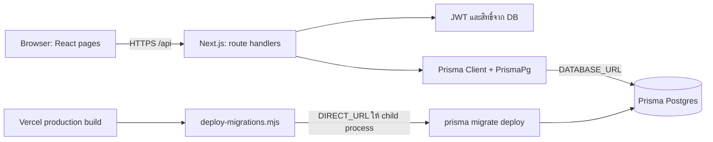

# บทที่ 7 — Deployment และ PostgreSQL บน cloud

อ้างอิง source วันที่ 15 ตุลาคม 2026 โดยเฉพาะ package.json, prisma.config.ts, scripts/deploy-migrations.mjs และ migrations ของวันที่ 23 กันยายน บทนี้อธิบาย configuration ที่มีอยู่จริงใน repository ไม่ได้เชื่อมตรวจฐานข้อมูล cloud หรือยืนยันว่า deployment ล่าสุดใช้ commit/ตัวแปรชุดใด

## 1. แอปกับฐานข้อมูลอยู่คนละส่วน

โค้ดเตรียมแอป Next.js สำหรับ Vercel และตรวจ host ของ Prisma Postgres ในขั้น migration ส่วน docker-compose.yml เป็น PostgreSQL 15 สำหรับเครื่องพัฒนา Docker container ในเครื่องไม่ได้ถูกยกขึ้น Vercel ตามการ deploy source โดยอัตโนมัติ



นี่เป็นภาพเส้นทางตาม configuration ไม่ใช่หลักฐานว่าตรวจ live infrastructure แล้ว PostgreSQL ยังเก็บ 8 models เดิม ได้แก่ User, VehicleType, Vehicle, Booking, Maintenance, Notification, Log, RolePermission; การย้ายที่ตั้ง DB ไม่ได้เปลี่ยน model ให้เป็นฐานข้อมูลชนิดอื่น

Browser ไม่เชื่อม DATABASE_URL เอง browser ส่ง request ให้ API; server จึงอ่าน JWT ตรวจสิทธิ์ ใช้ Prisma สั่ง query และส่ง JSON กลับไปให้ page/component แสดงผล รหัสเชื่อม DB จึงไม่ใช่ข้อมูลที่ต้องส่งเป็น props ให้ frontend

## 2. แยก build time, runtime และ seed time

| เวลา | จุดเริ่มต้น | งานที่ทำ | URL ที่ source ใช้ |
|---|---|---|---|
| build time | npm run build | generate client → deployment migration script → compile Next.js | migration script อ่าน DATABASE_URL แล้วส่ง DIRECT_URL ให้ Prisma CLI |
| runtime | HTTP request เข้าแอป | login/ตรวจสิทธิ์/query/update ข้อมูล | lib/prisma.ts อ่าน DATABASE_URL |
| manual migration | Prisma CLI อ่าน prisma.config.ts | ใช้ schema และ migrations ตามคำสั่ง | DIRECT_URL ถ้ามีค่าไม่เป็น null/undefined มิฉะนั้น DATABASE_URL |
| explicit seed | npx prisma db seed | รัน seed.ts แล้ว seedPermissions.ts | ทั้งสองสคริปต์สร้าง adapter โดยอ่าน DATABASE_URL เอง |

การตั้ง DIRECT_URL ไม่ได้ทำให้ runtime ใช้ direct URL ตามไปด้วย เพราะ lib/prisma.ts ไม่ได้อ่านตัวแปรนี้ และ config ของ CLI ไม่ได้แทนที่ connectionString ที่ seed scripts เขียนไว้เอง ดังนั้นหากตั้งสอง URL ต้องเข้าใจว่าชี้ฐานข้อมูลเดียวกันหรือไม่

## 3. อ่านคำสั่ง build ทีละขั้น

[package.json](/Users/chatchaponchuwongwut/Desktop/mut/project_1/vehicle-management/package.json) กำหนด:

```text
prisma generate && node scripts/deploy-migrations.mjs && next build
```

1. `prisma generate` สร้าง Prisma Client และ types จาก schema ไปยัง output ที่กำหนด คือ app/generated/prisma การ generate ไม่ได้สร้าง/แก้ตารางใน DB
2. `node scripts/deploy-migrations.mjs` ตัดสินใจว่าจะ migrate หรือข้ามตาม VERCEL_ENV แล้วส่ง exit code กลับ shell
3. `next build` สร้าง production build ของ Next.js หลังขั้นก่อนหน้าสำเร็จ

`&&` หมายถึงทำขั้นถัดไปเมื่อขั้นก่อนหน้าสำเร็จ ถ้า migration script ล้มเหลวจะไม่ถึง next build แต่ถ้า migration สำเร็จแล้ว next build ล้มเหลว ไม่ได้มีโค้ดครอบสามขั้นให้ rollback DB ทั้งหมดกลับอัตโนมัติ

## 4. deploy-migrations.mjs ทำอะไรทุกช่วง

เปิด [scripts/deploy-migrations.mjs](/Users/chatchaponchuwongwut/Desktop/mut/project_1/vehicle-management/scripts/deploy-migrations.mjs) ประกอบตารางนี้:

| โค้ด/เงื่อนไข | เหตุผลและผลที่เกิด |
|---|---|
| import spawnSync จาก node:child_process | เตรียมเรียก Prisma CLI เป็น process ลูกและรอให้จบก่อนเดินต่อ |
| VERCEL_ENV !== "production" | จบ script ด้วย exit 0; local หรือ preview จึงข้าม automatic migration ใน script นี้ |
| อ่าน DATABASE_URL | ต้องมี URL ฐานข้อมูลสำหรับ production; ถ้าไม่มียก error |
| new URL(pooledUrl) | แยก protocol, hostname และส่วนอื่นอย่างเป็นโครงสร้าง; URL ผิดรูปแบบอาจ throw ตรงนี้ |
| protocol ต้องเป็น postgres: หรือ postgresql: | script รองรับ connection string PostgreSQL สองรูปแบบนี้ ไม่รับ prisma+postgres: |
| hostname ต้องเป็น pooled.db.prisma.io หรือ db.prisma.io | จำกัดผู้ให้บริการตาม implementation; URL PostgreSQL จาก host อื่นจะถูกปฏิเสธโดย script นี้ |
| directUrl.hostname = "db.prisma.io" | ใช้ direct host สำหรับ CLI โดยคงส่วน credentials, database, port/query ที่มากับ URL |
| เลือก node_modules/.bin/prisma หรือ prisma.cmd | เลือก executable ของ dependency ในโครงการ โดยรองรับชื่อไฟล์ของ Windows ด้วย |
| spawnSync(prisma, ["migrate", "deploy"], ...) | รัน migrations ที่ commit ไว้และยังไม่ถูก apply; ไม่สร้าง migration ใหม่จาก schema |
| env: { ...process.env, DIRECT_URL: directUrl.toString() } | ส่ง environment เดิมพร้อม DIRECT_URL ที่คำนวณใหม่ให้ process ลูก โดยแทนค่า DIRECT_URL เดิมของ child |
| stdio: "inherit" | แสดงผล Prisma CLI ใน log ของขั้น build |
| ถ้า result.error ให้ throw | รับกรณีเริ่ม child process ไม่สำเร็จ |
| process.exit(result.status ?? 1) | ส่งสถานะ CLI กลับ build; หากไม่มี status ให้ถือว่าล้มเหลว |

ชื่อตัวแปร pooledUrl เป็นเพียงชื่อใน script; ปัจจุบันรับได้ทั้ง pooled host และ direct host เมื่อรับ direct host อยู่แล้ว การกำหนด hostname ซ้ำไม่ได้เปลี่ยนไปใช้ host อื่น

Script นี้ไม่ได้เขียนไฟล์ .env, ไม่เปลี่ยน DATABASE_URL สำหรับเว็บ และไม่ได้เรียก seed.ts โดยตรง แต่ migrate deploy อาจเติมข้อมูลเดโมได้เพราะมี SQL data migrations อยู่ในโฟลเดอร์ migrations แล้ว

เงื่อนไข skip migration ไม่ใช่ระบบแยกฐานข้อมูล production/preview: preview ยังอาจเชื่อม DB ตาม DATABASE_URL ของ environment นั้น การแยกข้อมูลขึ้นอยู่กับค่าที่ตั้งจริง ไม่ใช่ VERCEL_ENV เพียงตัวเดียว

## 5. Pooled URL กับ direct URL ต่างกันอย่างไรในโครงการนี้

แบบ pooled มีตัวกลางจัดการ connection ของแอปก่อนถึง DB ส่วนแบบ direct ใช้ปลายทางตรงของบริการ แผนที่ในโค้ดนี้คือ runtime อ่าน DATABASE_URL ตามที่ตั้งไว้ และ production migration ใช้ direct host ที่ script สร้างให้

```text
runtime:
DATABASE_URL → lib/prisma.ts → PrismaPg → query จาก API

production migration:
DATABASE_URL → ตรวจ protocol/host → เปลี่ยน host เป็น db.prisma.io
  → DIRECT_URL ของ child process
  → prisma.config.ts → prisma migrate deploy
```

[prisma.config.ts](/Users/chatchaponchuwongwut/Desktop/mut/project_1/vehicle-management/prisma.config.ts) ใช้ `process.env["DIRECT_URL"] ?? process.env["DATABASE_URL"]` เครื่องหมาย `??` fallback เฉพาะ null/undefined จึงไม่ตีความ empty string ว่าไม่มีค่า อย่าอธิบายว่าตั้ง DIRECT_URL เป็นข้อความว่างแล้วระบบจะกลับไปใช้ DATABASE_URL เสมอ

[lib/prisma.ts](/Users/chatchaponchuwongwut/Desktop/mut/project_1/vehicle-management/lib/prisma.ts) สร้าง PrismaPg adapter และ PrismaClient จาก DATABASE_URL โดยใช้ globalThis เก็บ client ใน development เพื่อช่วยไม่สร้าง client ใหม่ซ้ำเมื่อ hot reload ส่วนการ cache นี้ไม่ใช่ connection pool กลางที่แชร์ข้ามเครื่องหรือทุก server instance

## 6. Migration ใหม่สองชุดและผลต่อ schema

[20260923140000_seed_demo_data](/Users/chatchaponchuwongwut/Desktop/mut/project_1/vehicle-management/prisma/migrations/20260923140000_seed_demo_data/migration.sql) เป็น data migration:

- เพิ่มบัญชี Admin เดโม โดย SQL มี password hash ที่กำหนดไว้ใน migration; ไม่อ่าน SEED_ADMIN_PASSWORD
- เพิ่มประเภทรถ Van, Cable Car, Truck เมื่อยังไม่พบชื่อนั้น
- เพิ่มรถ ABC-1234, DEF-5678, GHI-9012 พร้อมเลขไมล์เริ่ม 15000, 42000, 8500 ตามลำดับ โดยอ้าง typeId ที่ค้นจากชื่อประเภท
- User ใช้เงื่อนไข conflict ที่ email และ Vehicle ที่ plateNumber เพื่อข้ามแถวที่มีอยู่ ไม่ได้อัปเดตทับรหัสผ่านหรือเลขไมล์รถเดิม

[20260923150000_seed_admin_permissions](/Users/chatchaponchuwongwut/Desktop/mut/project_1/vehicle-management/prisma/migrations/20260923150000_seed_admin_permissions/migration.sql) เติมคู่ role/permission ของ ADMIN จำนวน 13 สิทธิ์ ใช้ ON CONFLICT (role, permission) DO NOTHING จึงรักษาคู่ที่มีอยู่แล้วไว้ และไม่ล้างสิทธิ์เดิมทั้งหมด

ทั้งสองไฟล์ไม่ได้เพิ่มตารางหรือ field ใหม่ Schema จึงยังเป็นชุด 8 models เดิม แม้จำนวน migration เพิ่มขึ้น กรรมการถามว่า migration ต้องเป็น ALTER TABLE เท่านั้นหรือไม่ ให้ยกตัวอย่าง INSERT ในสองไฟล์นี้ได้

คำว่าไม่สร้างแถวซ้ำในกรณีดังกล่าวไม่ได้แปลว่าข้อมูล cloud ถูก reset ให้ตรงตัวอย่างทุก deploy ถ้ามีแถวเดิมต่างจากข้อมูลใน script ก็อาจคงค่าเดิมไว้ และ Prisma CLI ยังมีประวัติ migration สำหรับติดตามชุดที่ apply แล้ว

Migration เติมสิทธิ์ใหม่นี้เน้น ADMIN ไม่ใช่การเรียก DEFAULT_PERMISSIONS ให้ครบทั้งสาม role ข้อมูล USER/APPROVER ที่ครบจริงต้องพิจารณาสิ่งที่เคย seed/ตั้งค่าในฐานข้อมูลนั้นด้วย

## 7. seed.ts กับ seedPermissions.ts ในฉบับใหม่

คำสั่ง seed ที่ prisma.config.ts และ package.json ระบุคือ:

```text
tsx prisma/seed.ts && tsx prisma/seedPermissions.ts
```

[seed.ts](/Users/chatchaponchuwongwut/Desktop/mut/project_1/vehicle-management/prisma/seed.ts) ทำงานตามลำดับ:

1. โหลด environment และตรวจว่ามี DATABASE_URL
2. อ่าน hostname แล้วเทียบกับรายการ local ใน source คือ localhost, 127.0.0.1, ::1 การจัดกลุ่มนี้อิงผลที่ URL parser คืนมาและรายการที่เขียนไว้ ไม่ใช่การตรวจเครือข่ายทุกแบบ
3. เลือก SEED_ADMIN_PASSWORD หรือค่า fallback สำหรับ host ที่จัดเป็น local; ถ้าขาดรหัส หรือ host ถูกจัดเป็น remote แล้วรหัสสั้นกว่า 12 ตัวอักษร จะหยุดก่อนทำงาน
4. สร้าง adapter/client และอ่าน SEED_ADMIN_EMAIL หรือใช้อีเมล Admin เริ่มต้นที่กำหนดใน source
5. ค้นบัญชีตาม email ถ้ายังไม่มีจึง bcrypt.hash ด้วย cost 10 และสร้าง ADMIN หากมีอยู่แล้วเพียงรายงานว่ามีบัญชี ไม่แก้รหัสผ่านหรือ role เดิม
6. ตรวจและเพิ่มประเภทรถ/รถตัวอย่างที่ยังไม่มี แล้ว disconnect

การเรียก getAdminPassword เกิดก่อน query บัญชีเดิม ดังนั้น remote seed ยังต้องรับรหัสที่ผ่านเงื่อนไขแม้มี Admin อยู่แล้ว อย่าใช้การใส่ SEED_ADMIN_PASSWORD ใหม่เป็นวิธีเปลี่ยนรหัสบัญชีเดิม เพราะ source ไม่มี update ในกรณีนั้น

[seedPermissions.ts](/Users/chatchaponchuwongwut/Desktop/mut/project_1/vehicle-management/prisma/seedPermissions.ts) วน DEFAULT_PERMISSIONS ของ ADMIN, APPROVER, USER แล้ว upsert คู่ role_permission ด้วย update ว่างและ create คู่ที่ยังไม่มี เป็นการเติม baseline ไม่ล้างทุกสิทธิ์ และอาจเพิ่มสิทธิ์ baseline ที่ผู้ดูแลเคยถอดออกให้กลับมาเมื่อ seed ซ้ำ

| ประเด็น | SQL data migration | explicit seed command |
|---|---|---|
| เริ่มเมื่อใด | migrate deploy เจอ migration ที่ยังไม่ apply | เรียก prisma db seed โดยตั้งใจ |
| แหล่งข้อมูล Admin | literal และ hash ในไฟล์ SQL | ค่า environment/ค่าเริ่มต้นใน seed.ts |
| บัญชีที่มีอยู่ | conflict ตาม email แล้วข้าม | findUnique แล้วข้าม |
| สิทธิ์ใหม่ที่กล่าวถึง | migration ล่าสุดเติม ADMIN | seedPermissions เติม defaults ทั้ง 3 role |
| ตรวจรหัส remote ≥12 | ไม่ผ่าน function นี้ | seed.ts ตรวจ |
| เพิ่ม/แก้ schema | สองชุดใหม่นี้เติมข้อมูลอย่างเดียว | เติมข้อมูลใน schema ที่มีแล้ว |

`app/constants.ts` มี TEST_ACCOUNTS สำหรับปุ่มเติมฟอร์มหน้า login เป็นข้อมูลอีกชุดหนึ่ง ไม่ได้สร้างบัญชี USER/APPROVER ใน DB และไม่รับประกันว่ารหัส Admin ที่แสดงจะตรงบัญชี cloud ที่สร้างจาก migration หรือ seed

## 8. ตัวแปรที่เกี่ยวข้องและผู้ใช้ค่า

| ตัวแปร | ผู้อ่าน | ความหมาย |
|---|---|---|
| DATABASE_URL | lib/prisma.ts, seed scripts, deployment script, CLI fallback | URL PostgreSQL ฝั่ง server ต้องชี้ฐานข้อมูลที่ต้องการจริง |
| DIRECT_URL | prisma.config.ts | URL สำหรับ Prisma CLI; production script สร้างและส่งให้ child process เอง |
| VERCEL_ENV | deploy-migrations.mjs | เฉพาะค่า production จึงรัน automatic migration |
| NODE_ENV | Prisma runtime และ login cookie | production ไม่ใช้ global dev cache แบบเดียวกัน; cookie ใช้ secure และ sameSite strict |
| JWT_SECRET | auth/login และ lib/auth.ts | secret สำหรับ sign/verify JWT ต้องสอดคล้องกันระหว่าง instance ที่ใช้ session ร่วมกัน |
| SEED_ADMIN_EMAIL | seed.ts | อีเมลที่จะค้นหรือสร้าง Admin |
| SEED_ADMIN_PASSWORD | seed.ts | รหัสที่จะ hash เมื่อสร้าง Admin ใหม่; ไม่ใช่รหัสเชื่อม DB |
| NEXT_PUBLIC_API_URL | lib/api.ts ใน client | baseURL ของ Axios; เมื่อไม่มีค่าใช้ URL relative ของเว็บปัจจุบัน |
| EMAIL_ENABLED | lib/email/service.ts | ต้องเป็นข้อความ true จึงเปิดการส่งอีเมล |
| SMTP_HOST/SMTP_PORT/SMTP_USER/SMTP_PASS/EMAIL_FROM | email service | connection และผู้ส่งอีเมล; ตั้งครบตามการตรวจของ service |
| APP_BASE_URL | email templates | ฐาน URL สำหรับลิงก์จากอีเมลกลับเข้าเว็บ |
| OPENAI_API_KEY | AI generate.ts | credential เรียก provider จาก server |
| OPENAI_VEHICLE_SUMMARY_MODEL | AI generate.ts | เลือกชื่อโมเดล; หากไม่มีใช้ค่า default ใน source |

NEXT_PUBLIC_API_URL เป็นค่าที่ frontend ใช้ได้ จึงไม่ใช้ใส่ DB URL หรือ secret หาก frontend/API อยู่เว็บเดียวกัน ค่า relative ที่ source รองรับช่วยให้ request อยู่ origin เดียวกัน ไม่ต้องตั้ง URL localhost ไว้บน production

.env.example ยังไม่รวมตัวแปรใหม่ทุกตัวในตารางนี้ การมีไฟล์ตัวอย่างหรือค่าตั้งไว้บนเครื่องไม่ได้ยืนยันว่า deployment environment มีค่าชุดเดียวกัน คู่มือนี้ไม่บันทึก connection string หรือ credential จริง

## 9. เส้นทางหนึ่ง request หลัง deploy

ยกตัวอย่าง login: Browser ส่ง POST /api/auth/login → handler ค้น User ด้วย Prisma บน DB ที่ DATABASE_URL ชี้ → ตรวจ isActive และ bcrypt → sign JWT → set cookie httpOnly → browser ส่ง cookie มากับ request ต่อไป → lib/auth.ts verify และอ่านผู้ใช้ล่าสุด → permissions ตรวจสิทธิ์จาก RolePermission → handler ทำงานกับ DB

production login cookie ตั้ง secure=true และ sameSite=strict ตาม NODE_ENV จึงควรอธิบายการใช้ผ่าน HTTPS และเข้าใจว่าการย้าย frontend/API ข้าม site ไม่ใช่ configuration เดียวกับเว็บ origin เดียวที่ source ใช้เป็นค่าเริ่มต้น

ตัวอย่างการดูรายงาน: page ส่ง filters ให้ API → server อ่าน Booking/Maintenance/Vehicle → คำนวณ metrics → JSON กลับไปให้ HistoryStats/HistoryCharts/HistoryTable; AI ทำงานเพิ่มเมื่อขอสร้างบทสรุป โดยรับข้อมูลรวมตามบท 4 การ deploy ไม่ได้ย้ายสูตร metrics ไปให้ AI คิดเอง

## 10. คำสั่งและความหมายสำหรับการอธิบายงาน

ตารางนี้อธิบายคำสั่งที่โครงการใช้ ไม่ใช่บันทึกว่ารันทั้งหมดในการจัดทำคู่มือครั้งนี้

| คำสั่ง | ใช้ทำอะไร |
|---|---|
| npm run dev | พัฒนา Next.js ในเครื่อง; ไม่มีการเรียก deployment migration script ในคำสั่งนี้ |
| docker compose up -d | เปิด PostgreSQL local ตาม compose; ไม่ได้ deploy DB ไป cloud |
| npx prisma generate | สร้าง client/types จาก schema |
| npx prisma migrate dev | จัดทำ/ใช้ migration ในวงจรพัฒนา ต้องเลือกฐานข้อมูลพัฒนา |
| npx prisma migrate deploy | apply pending migrations ที่เตรียมไว้บน DB ที่ config เลือก |
| npx prisma db seed | เรียก seed command ที่กำหนดไว้ ซึ่งรอบนี้รันสองสคริปต์ตามลำดับ |
| npm run build | generate → production migration ตามเงื่อนไข → next build |
| npm run start | รัน Next production server หลังมี build แล้ว |

ไม่มีคำสั่ง deploy Vercel หรือไฟล์ vercel.json ที่จำเป็นต่อการอธิบาย script นี้ในคู่มือ: หลักฐานที่ใช้คือการตรวจ VERCEL_ENV และ host ใน source ส่วนโดเมนจริง region และ environment ที่ dashboard ตั้งไว้ยังไม่ได้ตรวจ

## 11. สิ่งที่ผลตรวจรอบนี้บอกได้

- Vitest ผ่าน 24 ไฟล์/99 tests: หลักฐานว่าชุดทดสอบที่มีผ่านกับ working tree ปัจจุบัน ซึ่งใช้ mocks หลายส่วน
- TypeScript ผ่าน: ตรวจความสอดคล้องของ types/imports รวม component ที่ย้ายแล้ว
- lint exit 0: ไม่มี lint error เหลือ warning unused import ใน mock 1 จุด
- ไม่ได้รัน production build, E2E, migrate, seed หรือ smoke test เว็บ cloud จึงยังไม่ใช่หลักฐานว่าค่าเชื่อม DB, schema ที่ deploy จริง และข้อมูลเดโมใน environment ปลายทางตรงกันครบ

เวลาสอบให้แยก “ระบบถูกออกแบบและตั้งค่าให้ทำอย่างไร” ออกจาก “ผลที่ทดสอบบน deployment แล้วเป็นอย่างไร” หากจะยืนยันอย่างหลังควรใช้ build/migration log และการทดลอง flow บน deployment นั้นประกอบ
